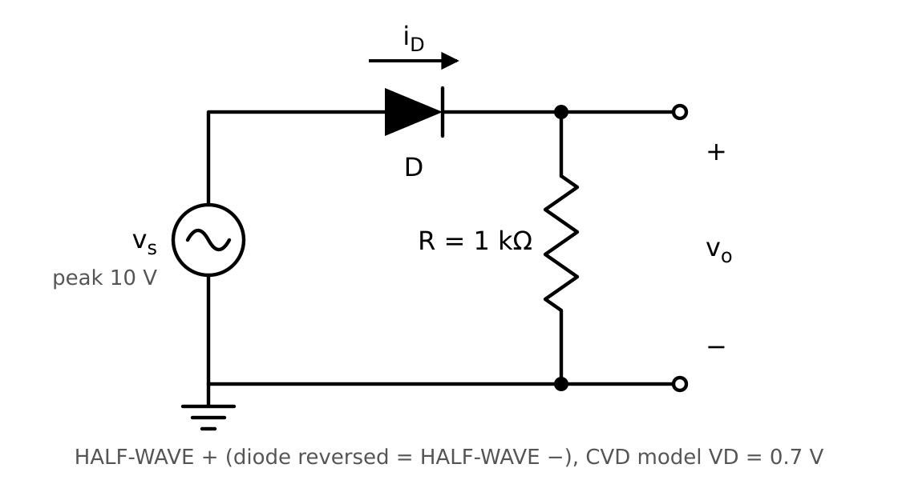
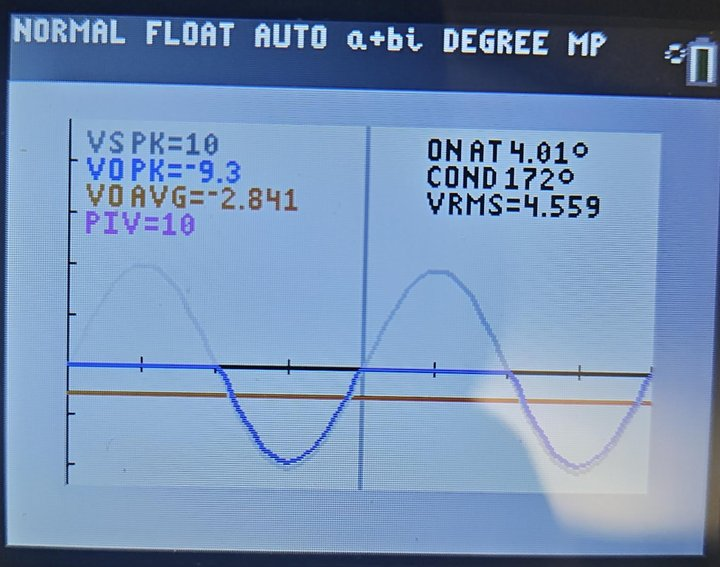
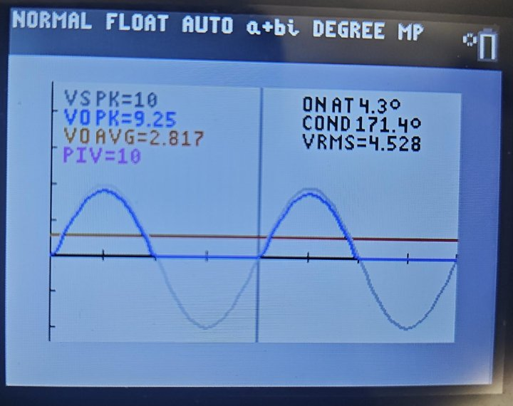

# RECT — Rectifier solver with waveform plot for TI-84 Plus CE

A TI-BASIC program that solves diode rectifier circuits with the constant-voltage-drop (CVD) diode model, with or without a filter capacitor, and plots `vs` and `vo` with the key values marked on the graph. The RECTIFIER menu of [DIODE](https://github.com/INLEI12138/ti84-diode) opens this program.

一个 TI-84 Plus CE 上的 TI-BASIC 整流电路求解程序：用二极管恒压降（CVD）模型计算，可带或不带滤波电容，并画出 `vs` 和 `vo` 的波形，关键数值直接标在图上。[DIODE](https://github.com/INLEI12138/ti84-diode) 的 RECTIFIER 菜单也会打开这个程序。

---

## Features

1. Four circuits: **HALF-WAVE +** (diode conducts on the positive half), **HALF-WAVE −** (diode reversed), **FULL-WAVE CT** (center-tapped), **BRIDGE**
2. Results page
   - `VO PEAK` — peak output (`VP − VD`, or `VP − 2VD` for a bridge)
   - `VO AVG EXACT` — average output by exact integration over the conduction interval
   - `VO AVG APPROX` — the textbook estimate `(VP − VD)/π` (×2 for full-wave)
   - `VRMS`, `PIV`, the angle where conduction starts (`ON AT`), conduction angle (`COND`), peak and average load current
3. Graph: two periods of `vs` (gray) and `vo` (blue), the average output as an orange line, and `VS PK`, `VO PK`, `VO AVG`, `PIV`, `ON AT`, `COND`, `VRMS` written on the plot in matching colours
4. Unit suffixes on every input (same parser as [DIODE](https://github.com/INLEI12138/ti84-diode)): `10V`, `1K`, `4.7K`, `0.75V` — `M` is milli, `MEG` is mega
5. `VD` defaults to `0.7 V` and `R` to `1 kΩ` — just press `ENTER`
6. **Filter capacitor** (V3): enter `C` (e.g. `100U`; `ENTER` = none) and the line frequency (default 60 Hz). Results: `VO PEAK`, `VDC`, ripple `VR PP`, ripple frequency, `PIV`, conduction angle, `IL`, average and peak diode current (standard small-ripple approximations). The graph shows the smoothed output and VDC

## 功能

1. 四种电路：**HALF-WAVE +**（正半周导通）、**HALF-WAVE −**（二极管反接，负半周导通）、**FULL-WAVE CT**（中心抽头全波）、**BRIDGE**（桥式）
2. 结果页
   - `VO PEAK`：输出峰值（`VP − VD`，桥式为 `VP − 2VD`）
   - `VO AVG EXACT`：对导通区间精确积分得到的输出平均值
   - `VO AVG APPROX`：课本常用的近似值 `(VP − VD)/π`（全波乘 2）
   - `VRMS`、`PIV`、开始导通的角度（`ON AT`）、导通角（`COND`）、负载电流峰值和平均值
3. 波形图：两个周期的 `vs`（灰色）和 `vo`（蓝色），橙色水平线是输出平均值；`VS PK`、`VO PK`、`VO AVG`、`PIV`、`ON AT`、`COND`、`VRMS` 用同样的颜色标在图上
4. 所有输入都能带单位（和 [DIODE](https://github.com/INLEI12138/ti84-diode) 用同一套识别代码）：`10V`、`1K`、`4.7K`、`0.75V`。`M` 是毫，`MEG` 才是兆
5. `VD` 默认 `0.7 V`，`R` 默认 `1 kΩ`，直接按 `ENTER` 即可
6. **滤波电容**（V3）：输入 `C`（例如 `100U`，直接回车表示不接电容）和电源频率（默认 60 Hz）。输出 `VO PEAK`、`VDC`、纹波峰峰值 `VR PP`、纹波频率、`PIV`、导通角、`IL`、二极管平均和峰值电流（采用常用的小纹波近似公式）。波形图显示滤波后的输出和 VDC

---

## Install

1. Send `RECT.8xp` to the calculator with TI Connect CE (or paste `RECT.txt` into a new program named `RECT` and send that).
2. `PRGM` → `RECT` → `ENTER`.

Do not rename the program: the unit parser works by the program calling itself as `prgmRECT`. Exit the program before sending a new version, or TI Connect CE reports "Calculator is Busy".

## 安装

1. 用 TI Connect CE 把 `RECT.8xp` 发送到计算器（或者把 `RECT.txt` 粘贴到 TI Connect CE 编辑器里新建的名为 `RECT` 的程序中，再发送）。
2. 按 `PRGM` → 选 `RECT` → `ENTER`。

不要给程序改名：单位识别功能是靠程序以 `prgmRECT` 调用自己实现的。发送新版本前要先退出程序，否则 TI Connect CE 会提示 "Calculator is Busy"。

---

## Example / 示例

Input / 输入：`HALF-WAVE +` → `10` → `ENTER` → `ENTER`

| VO PEAK | VO AVG EXACT | VO AVG APPROX | VRMS | PIV | ON AT | COND | ID PEAK |
|---|---|---|---|---|---|---|---|
| 9.3 V | 2.8409 V | 2.9603 V | 4.5591 V | 10 V | 4.014° | 171.972° | 9.3 mA |

With the diode reversed (`HALF-WAVE −`) the output peak and average are −9.3 V and −2.8409 V; PIV is still 10 V.
二极管反接（`HALF-WAVE −`）时，输出峰值和平均值为 −9.3 V、−2.8409 V，PIV 仍为 10 V。

*HALF-WAVE −, VP = 10 V, VD = 0.7 V, R = 1 kΩ — gray: vs, blue: vo, orange: average of vo.*
*HALF-WAVE −，VP = 10 V、VD = 0.7 V、R = 1 kΩ。灰色：vs，蓝色：vo，橙色：vo 的平均值。*

With `VD = 0.75 V` and `R = 5 kΩ` / 当 `VD = 0.75 V`、`R = 5 kΩ` 时：VO PEAK 9.25 V, VO AVG 2.8171 V, VRMS 4.5279 V, ON AT 4.301°, COND 171.398°, ID PEAK 1.85 mA. The voltages do not depend on R. / 电压结果与 R 无关。

*HALF-WAVE +, VP = 10 V, VD = 0.75 V, R = 5 kΩ.*

With a filter capacitor / 带滤波电容：`HALF-WAVE +`, `10`, `ENTER`, `ENTER`, `100U`, `ENTER` (60 Hz)

| VO PEAK | VDC | VR PP | PIV | COND | IL | ID AVG | ID MAX |
|---|---|---|---|---|---|---|---|
| 9.3 V | 8.525 V | 1.55 V | 19.3 V | 33.08° | 9.3 mA | 110.51 mA | 211.72 mA |

All of these were checked on a TI-84 Plus CE and against numerical integration. / 以上结果都在 TI-84 Plus CE 实机上验证过，并与数值积分结果核对。

---

## Formulas / 公式

With `B = K·VD` (K = 1, or 2 for a bridge), `θ₁ = sin⁻¹(B / VP)` and `J = 1` (half-wave) or `2` (full-wave):

- `VO AVG = J · [2·VP·cos θ₁ − B(π − 2θ₁)] / (2π)`
- `VRMS² = J · [ (VP²/2)(π − 2θ₁ + sin 2θ₁) − 4·VP·B·cos θ₁ + B²(π − 2θ₁) ] / (2π)`
- `PIV`: half-wave `VP`, center-tapped `2VP − VD`, bridge `VP − VD`

## Notes / 注意事项

- With a capacitor, PIV is `VP + VO PEAK` for half-wave and center-tapped and `VP − VD` for a bridge; a warning appears if the ripple is larger than the peak (the approximation no longer holds). / 带电容时，半波和中心抽头的 PIV 为 `VP + VO PEAK`，桥式为 `VP − VD`；纹波超过峰值时会提示近似公式已不适用。
- The graph overwrites the window settings, turns off `Y=` functions and stat plots, and uses lists `L₁`–`L₃`. / 画图会覆盖窗口设置，关闭 `Y=` 函数和统计图，并使用列表 `L₁`–`L₃`。
- Needs a colour CE model. / 需要彩屏 CE 型号。

---

## Related programs / 相关程序

Other TI-84 Plus CE programs by INLEI / INLEI 的其他 TI-84 Plus CE 程序：

| Program / 程序 | Purpose | 用途 |
|---|---|---|
| [AMPCALC](https://github.com/INLEI12138/ti84-ampcalc) | Op-amp (inverting / non-inverting) gain, phase and Bode plot | 运放（反相/同相）增益、相位与 Bode 图 |
| [FILTER](https://github.com/INLEI12138/ti84-filter) | Passive RLC voltage-divider filter response and Bode plot | 无源 RLC 分压滤波器频率响应与 Bode 图 |
| [DIODE](https://github.com/INLEI12138/ti84-diode) | Diode circuits: Shockley, series R, Zener, rectifiers, small-signal rd | 二极管电路：肖克利方程、串联电阻、稳压管、整流、小信号电阻 |
| [ITER](https://github.com/INLEI12138/ti84-iteration) | Diode bias point by iteration, two-source mode, rd | 二极管工作点迭代求解（含双电源模式）与 rd |
| [ZFORMULA](https://github.com/INLEI12138/ti84-zformula) | Series / parallel RLC impedance formula reference | 串联/并联 RLC 阻抗公式速查 |

## Files / 文件说明

- `RECT.8xp` — program for the calculator / 可直接发送到计算器的程序
- `RECT.txt` — readable source / 可读的源码
- `images/half_wave.svg`, `.png` — example circuit / 示例电路图
- `images/calc_half_*.jpg` — photos of the calculator graph / 计算器波形图实拍

## License / 许可证

MIT
